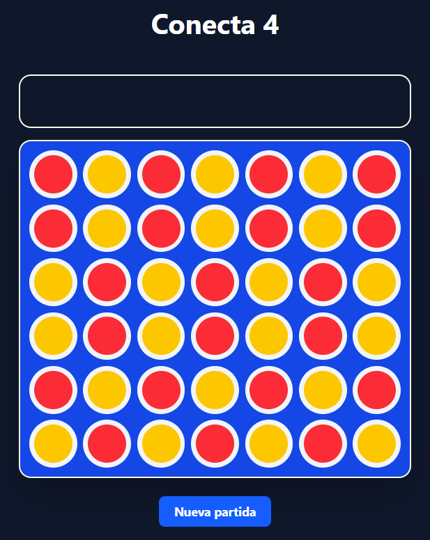

# IES Venancio Blanco 
# DAW2A - Desarrollo Web en Entorno Cliente
## 📝 Prueba Individual Práctica - Parte A

## **JS Vanilla**

## **Instrucciones**
- TODO EL CÓDIGO JS DEBE ESTAR PRESENTE ÚNICAMENTE EN EL FICHERO `conecta.js`.
- SE PERMITE ÚNICAMENTE EL TEMARIO DE LA ASIGNATURA A MODO DE REFERENCIA PARA REALIZAR LAS TAREAS PROPUESTAS.
- SE DEBE HACER UN CONTROL INTEGRO DE LOS ERRORES EN TODA LA APLICACIÓN, UTILIZA LAS HERRAMIENTAS **CONSOLA** Y **DEBUGGER** PRESENTES EN LAS **HERRAMIENTAS PARA DESARROLLADORES** DEL NAVEGADOR, **SE PERMITE SACAR LOGS Y WARNINGS**, PERO NO SE PERMITE QUE SALGA NINGUN TIPO DE ERROR POR CONSOLA O ERRORES DE EJECUCIÓN:
  - LA PRESENCIA DE 2 O MÁS ERRORES REPRESENTA UNA PENALIZACIÓN DE <span style="color:red">**-1.0**</span> PUNTO **SOBRE LA NOTA FINAL DE ESTA PARTE**.
- AL COMENZAR LA PRUEBA SE DEBE:
  - 1. PONER EN MARCHA EL PROGRAMA **ShareX** Y GRABAR LA PANTALLA ENTERA EN FORMATO **MPEG**, EN TODO MOMENTO DEBE ESTAR VISIBLE EN EL VÍDEO LA HORA Y LA FECHA DE LA BARRA DE TAREAS DE WINDOWS.
  - 2. HACER UN COMMIT INICIAL CON **GIT**.
  
- PUEDES HACER TODOS LOS COMMITS QUE CONSIDERES OPORTUNOS PERO SOLO DEBE HABER UNO LLAMADO "ENTREGA" Y SER EL ÚLTIMO.
- LA ENTREGA DE LA PRUEBA SE REALIZA HACIENDO UN COMMIT LLAMADO "ENTREGA" Y SUBIENDO EL PROYECTO AL REPOSITORIO HTTPS://HANDMADEGAMES.ORG
- EL VIDEO GRABADO POR EL PROGRAMA **ShareX** SE DEBE ENTREGAR MEDIANTE CONVERSACIÓN CON EL PROFESOR A TRAVÉS DE TEAMS.

- <span style="color:red">**EL EJERCICIO SE CONSIDERA NO SUPERADO SI SE REALIZA ALGUNA DE LAS SIGUIENTES CONSIDERACIONES:**</span > 
  - SE USA ALGUNA LIBRERÍA COMO JQUERY… 
  - SE MODIFICA ALGUNO DE LOS FICHEROS DIFERENTE A `conecta.js` O A `conecta.spec.js`.
  - SE HACE USO DE ALGUNA AYUDA COMO UN COMPAÑERO O DE INTELIGENCIA ARTIFICIAL, GENERE CÓDIGO DE MANERA AUTOMÁTICA O NO, COMO CHATGPT, COPILOT, TABNINE...
  - SE HACE USO DE ALGUNA PLANTILLA O PRÁCTICA EXTERNA.
  - NO SE ENTREGA EL VIDEO GRABADO POR EL PROGRAMA **ShareX**.
  - EL VIDEO GRABADO POR EL PROGRAMA **ShareX** TIENE CORTES. 
  - NO SE ENTREGA LA PRUEBA REALIZADA CON UN ÚLTIMO COMMIT LLAMADO "ENTREGA".
  - NO SE ENTREGA LA PRUEBA REALIZADA EN EL REPOSITORIO HTTPS://GIT.HANDMADEGAMES.ORG.

---

Se desea hacer una versión del juego CONECTA 4, un juego en el que dos jugadores compiten por colocar 4 de sus fichas seguidas en horizontal, vertical o diagonal, en un tablero vertical de 7 columnas por 6 filas.

Al principio, todas las casillas están vacías. Por turnos, un jugador toma las fichas amarillas y el otro las rojas, empiezan las amarillas y después van alternando por turnos.
 
El jugador que está en su turno elige una de las 7 columnas y deja caer tu ficha desde la parte superior. La ficha bajará por la columna hasta detenerse en la casilla libre más baja posible, no se puede elegir en qué fila ponerla, siempre cae al fondo o sobre otra ficha que ya esté ahí.

En el momento en que un jugador logra conectar 4 fichas seguidas de su color, la partida termina inmediatamente y ese jugador gana.

Si el tablero se llena por completo y ninguno de los dos logró alinear 4 fichas, la partida se declara en empate.

Las fichas llevan las siguientes clases Tailwind CSS:
- **AMARILLAS** `bg-yellow-400`
- **ROJAS** `bg-red-500`

Y las casillas vacías tienen el color: `bg-white`

En el tablero las fichas se colocan cambiando el color de fondo de los elementos `div` más internos del siguiente elemento `section`:
```html
<section class="border-2  border-amber-50 bg-blue-700 rounded-2xl p-3 shadow-2xl grid grid-cols-7 gap-2 aspect-7/6">
```

Por ejemplo, el siguiente `div` es una casilla vacía:
```html
<div class="w-4/5 h-4/5 rounded-full bg-white"></div>
```
Si quisieramos poner una ficha amarilla quitaríamos el fondo blanco y pondríamos el fondo amarillo, así:
```html
<div class="w-4/5 h-4/5 rounded-full bg-yellow-400"></div>
```

Y si quisieramos poner una ficha de coolor rojo, sería así:
```html
<div class="w-4/5 h-4/5 rounded-full bg-red-500"></div>
```



<div style="page-break-after: always;"></div>


## TAREA 1.

### Tarea 1.1 

Crea una función que permita limpiar el tablero, es decir, esta función debe poner todas las casillas de color blanco.

---

## TAREA 2

### Tarea 2.1

Haz que cuando el ratón este encima (*mouseover*) de alguno de los `div` que son hijos del siguiente elemento:

```html
<section class="rounded-2xl border-2 border-amber-50 grid grid-cols-7 gap-2 mb-4 cursor-none">
```

se añada como un hijo de ese `div`, otro elemento `div` con las siguientes clases de Tailwind CSS: `w-4/5`, `h-4/5`, `rounded-full`, `bg-yellow-400`.

Solo se debe añadir un único `div`, así, los `div` que son hijos del siguiente elemento:

```html
<section class="rounded-2xl border-2 border-amber-50 grid grid-cols-7 gap-2 mb-4 cursor-none">
```

o no tienen hijos o tienen un único `div` con las siguientes clases de Tailwind CSS: `w-4/5`, `h-4/5`, `rounded-full`, `bg-yellow-400`.

 
### Tarea 2.2 

Haz que cuando el ratón salga ds estar encima de alguno de los `div` que son hijos del siguiente elemento:

```html
<section class="rounded-2xl border-2 border-amber-50 grid grid-cols-7 gap-2 mb-4 cursor-none">
```

si tenían un hijo `div` con las siguientes clases de Tailwind CSS: `w-4/5`, `h-4/5`, `rounded-full`, `bg-yellow-400` se elimine, ya no tenga hijos.

---

## TAREA 3

### Tarea 3.1 


Haz que cuando el ratón este encima de alguno de los `div` que son hijos del siguiente elemento:

```html
<section class="rounded-2xl border-2 border-amber-50 grid grid-cols-7 gap-2 mb-4 cursor-none">
```

**si se hace click con el ratón** se añada al tablero definido por el elemento `section`:
```html
<section class="border-2  border-amber-50 bg-blue-700 rounded-2xl p-3 shadow-2xl grid grid-cols-7 gap-2 aspect-7/6">
```

una ficha del mismo color que el que muestra el `div`, que es hijo de ese `div`, cumpliendo las reglas descritas arriba (se debe colocar en la casilla libre más abajo que se alinee verticalmente), si esa columna está completa de fichas no hará nada.

Si se hace clic con el ratón en cualquier otra parte de la pagina web no debe hacerse nada.


### Tarea 3.2 

Haz que al colocar una ficha satisfactoriamente en el tablero, se cambie el color de fondo del `div` que se crea cuando el ratón este encima (*mouseover*) de alguno de los `div` que son hijos del siguiente elemento:

```html
<section class="rounded-2xl border-2 border-amber-50 grid grid-cols-7 gap-2 mb-4 cursor-none">
```

alternadose de amarillo a rojo, y de rojo a amarillo.


---

## TAREA 4

### Tarea 4.1 

Haz que cuando se coloca una ficha satisfactoriamente en el tablero, se compruebe que si hay 4 **fichas** de ese color en horizontal o vertical.

Si las hay, entonces se debe detener el juego y no se debe permitir colocar más fichas.

Además, se mostrará el mensaje "GANARON AMARILLAS" si el color de esta última ficha colocada es de color `bg-yellow-400`, o "GANARON ROJAS" en otro caso.


### Tarea 4.2 

Haz que cuando se pulse el botón con el texto "Nueva partida" se inicie todo el juego de nuevo:
- Se limpia el tablero.
- Comienzan las amarillas
- Se borra el texto si lo hubiera de "GANARON ..."
- Se pueden colocar fichas en el tablero, alternandose el color.


